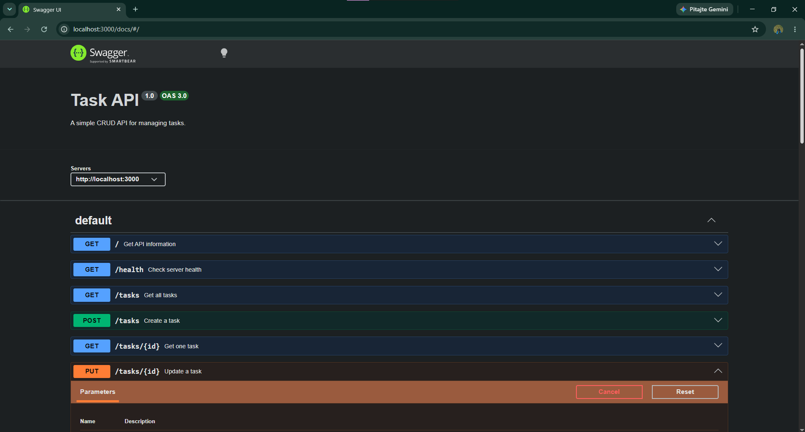
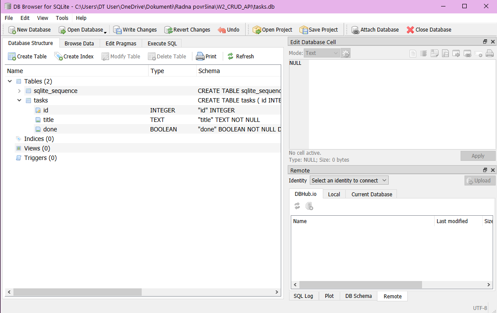
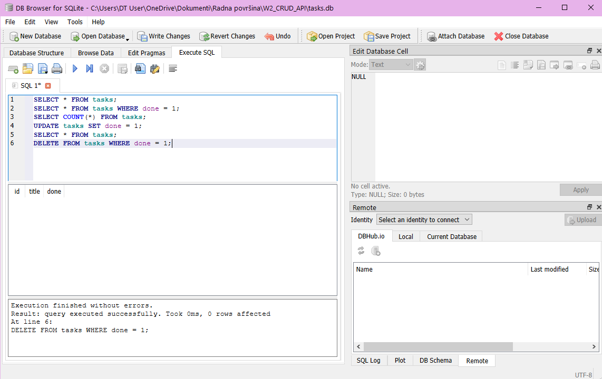

# 🚀 W3 A1 — Task CRUD API with SQLite

A simple REST API built with **Node.js** and **Express** for managing a to-do list.

This project implements the complete **CRUD** cycle:

> **Create → Read → Update → Delete**

The API uses a **SQLite database** for persistent task storage. The API endpoints remain the same as in the previous assignment, but tasks are now stored permanently in a database instead of an in-memory array.

---

## ✨ Features

- ✅ REST API built with Express
- ✅ Create tasks
- ✅ Read all tasks
- ✅ Read a single task
- ✅ Update tasks
- ✅ Delete tasks
- ✅ Input validation
- ✅ Proper HTTP status codes
- ✅ Swagger UI documentation
- ✅ OpenAPI specification
- ✅ SQLite database
- ✅ Persistent data storage
- ✅ Automatic database creation
- ✅ Automatic table creation
- ✅ SQL-based CRUD operations
- ✅ Git and GitHub version control

---

## 🛠️ Technologies

| Technology | Purpose |
|---|---|
| 🟨 JavaScript | Programming language |
| 🟢 Node.js | Runtime environment |
| 🚂 Express | Web framework |
| 🗄️ SQLite | Database |
| 🟨 better-sqlite3 | SQLite database library |
| 📖 Swagger UI | Interactive API documentation |
| 📋 OpenAPI | API specification |
| 🔧 Git | Version control |
| 🐙 GitHub | Code hosting |

---

# 📦 Installation

Clone the repository and open the project folder.

Install all required dependencies:

```bash
npm install
````

The project uses `better-sqlite3` to connect the Express API to SQLite.

---

# ▶️ Running the API

Start the server with:

```bash
node server.js
```

The server will start at:

```text
http://localhost:3000
```

You should see:

```text
Server running on http://localhost:3000
```

---

## 🗄️ Database

The application uses **SQLite** for persistent data storage.

The database file is:

```text
tasks.db
```

The database is stored in the project folder.

When the application starts, it automatically:

* creates the `tasks.db` database if it does not exist
* creates the `tasks` table if it does not exist
* inserts the example tasks when the database is initially empty

The `tasks` table contains:

| Column  | Type    | Description                             |
| ------- | ------- | --------------------------------------- |
| `id`    | INTEGER | Primary key and unique task ID          |
| `title` | TEXT    | Task title                              |
| `done`  | BOOLEAN | Indicates whether the task is completed |

Because the data is stored in SQLite, tasks remain available after restarting the server.

---

# 📖 Swagger UI

The API has interactive Swagger documentation.

Open:

```text
http://localhost:3000/docs
```

Swagger UI allows you to test all API endpoints directly from the browser using the **Try it out** button.

## 📸 Swagger UI



---

# 🔗 API Endpoints

| Method    | Endpoint     | Description                     |
| --------- | ------------ | ------------------------------- |
| 🟢 GET    | `/`          | Returns API information         |
| 🟢 GET    | `/health`    | Checks if the server is running |
| 🔵 GET    | `/tasks`     | Returns all tasks               |
| 🔵 GET    | `/tasks/:id` | Returns one task                |
| 🟡 POST   | `/tasks`     | Creates a new task              |
| 🟠 PUT    | `/tasks/:id` | Updates an existing task        |
| 🔴 DELETE | `/tasks/:id` | Deletes a task                  |

---

# 📝 Task Structure

Each task has the following structure:

```json
{
  "id": 1,
  "title": "Learn REST APIs",
  "done": false
}
```

## Properties

| Property | Type    | Description                             |
| -------- | ------- | --------------------------------------- |
| `id`     | Number  | Unique task ID                          |
| `title`  | String  | Task title                              |
| `done`   | Boolean | Indicates whether the task is completed |

---

# 🔄 CRUD Operations

## 🟢 1. GET — API Information

### Request

```http
GET /
```

### Response

```json
{
  "name": "Task API",
  "version": "1.0",
  "endpoints": [
    "/tasks"
  ]
}
```

**Status:** `200 OK`

---

## 💚 2. GET — Health Check

### Request

```http
GET /health
```

### Response

```json
{
  "status": "ok"
}
```

**Status:** `200 OK`

---

## 📋 3. GET — All Tasks

### Request

```http
GET /tasks
```

### Example Response

```json
[
  {
    "id": 1,
    "title": "Learn REST APIs",
    "done": false
  },
  {
    "id": 2,
    "title": "Build CRUD API",
    "done": false
  },
  {
    "id": 3,
    "title": "Test API endpoints",
    "done": true
  }
]
```

**Status:** `200 OK`

The tasks are retrieved using a SQL `SELECT` query from the SQLite database.

---

## 🔎 4. GET — Single Task

### Request

```http
GET /tasks/1
```

### Response

```json
{
  "id": 1,
  "title": "Learn REST APIs",
  "done": false
}
```

**Status:** `200 OK`

### Task Not Found

Request:

```http
GET /tasks/99
```

Response:

```json
{
  "error": "Task 99 not found"
}
```

**Status:** `404 Not Found`

---

## ➕ 5. POST — Create a Task

### Request

```http
POST /tasks
```

### Request Body

```json
{
  "title": "Buy milk"
}
```

The server automatically:

* assigns a unique ID
* sets `done` to `false`
* inserts the task into the SQLite database

### Response

```json
{
  "id": 4,
  "title": "Buy milk",
  "done": false
}
```

**Status:** `201 Created`

---

## 💻 POST Example with curl

```bash
curl -i -X POST http://localhost:3000/tasks \
-H "Content-Type: application/json" \
-d '{"title":"Buy milk"}'
```

Expected response:

```text
HTTP/1.1 201 Created
```

---

## ⚠️ POST Validation

The API validates the task title.

An empty or missing title is not accepted.

### Invalid request

```json
{}
```

or:

```json
{
  "title": ""
}
```

### Response

```json
{
  "error": "Title is required."
}
```

**Status:** `400 Bad Request`

---

## ✏️ 6. PUT — Update a Task

### Request

```http
PUT /tasks/1
```

### Request Body

```json
{
  "title": "Learn Express",
  "done": true
}
```

### Response

```json
{
  "id": 1,
  "title": "Learn Express",
  "done": true
}
```

**Status:** `200 OK`

The task is updated using a SQL `UPDATE` query.

---

## ❌ Updating a Non-existing Task

Request:

```http
PUT /tasks/99
```

Response:

```json
{
  "error": "Task 99 not found"
}
```

**Status:** `404 Not Found`

---

## 🗑️ 7. DELETE — Delete a Task

### Request

```http
DELETE /tasks/1
```

If the task exists, it is removed from the SQLite database.

**Response:**

```text
204 No Content
```

The response body is empty.

---

## ❌ Deleting a Non-existing Task

Request:

```http
DELETE /tasks/99
```

Response:

```json
{
  "error": "Task 99 not found"
}
```

**Status:** `404 Not Found`

---

# 📊 HTTP Status Codes

| Status Code | Meaning     | Used for             |
| ----------- | ----------- | -------------------- |
| 🟢 200      | OK          | Successful GET / PUT |
| 🟢 201      | Created     | Successful POST      |
| 🟢 204      | No Content  | Successful DELETE    |
| 🟡 400      | Bad Request | Invalid input        |
| 🔴 404      | Not Found   | Task does not exist  |

---

# 💾 Data Storage

This version of the project uses **SQLite** instead of an in-memory array.

SQLite is a lightweight relational database stored in a single file. It does not require a separate database server.

The database file is:

```text
tasks.db
```

The application uses the **better-sqlite3** library to communicate with SQLite.

The database schema contains a `tasks` table with:

```text
id
title
done
```

The database and table are created automatically when the application starts if they do not already exist.

The CRUD endpoints use SQL queries for:

* `SELECT`
* `INSERT`
* `UPDATE`
* `DELETE`

This means that task data survives server restarts.

---

# 📸 Database Viewer

The database was opened and inspected using **DB Browser for SQLite**.

The `tasks` table contains the task records and the columns:

```text
id | title | done
```



---

# 🧪 SQL Query Example

SQL queries were executed manually using the **Execute SQL** section of DB Browser for SQLite.

Example query:

```sql
SELECT * FROM tasks;
```

This query returns all tasks stored in the database.



Other SQL queries tested during the assignment include:

```sql
SELECT * FROM tasks WHERE done = 1;
```

```sql
SELECT COUNT(*) FROM tasks;
```

```sql
UPDATE tasks SET done = 1;
```

```sql
DELETE FROM tasks WHERE done = 1;
```

The changes made directly in the database were verified through the API.

---

# 🧪 Testing

The API was tested using:

💻 PowerShell / HTTP requests
🌐 Browser
📖 Swagger UI
🗄️ DB Browser for SQLite

The complete CRUD cycle was tested:

```text
POST → Create
   ↓
GET → Read
   ↓
PUT → Update
   ↓
DELETE → Delete
```

The required status codes were also tested:

```text
201 → Created
200 → Successful request
204 → Deleted
400 → Invalid input
404 → Task not found
```

Database persistence was also tested by:

1. Creating tasks.
2. Restarting the server.
3. Sending `GET /tasks`.
4. Confirming that the tasks were still stored.

---

# 📁 Project Structure

```text
W2_CRUD_API/
│
├── 📄 server.js
├── 📄 db.js
├── 📄 openapi.json
├── 📄 package.json
├── 📄 package-lock.json
├── 📄 README.md
├── 🗄️ tasks.db
├── 🖼️ swagger.png
├── 🖼️ baza.png
├── 🖼️ execute.png
├── 📄 .gitignore
└── 📁 node_modules/
```

`node_modules` is excluded from Git using `.gitignore`.

---

# 🪜 Development Stages

## Stage 0 — Hello Server

Created the initial Express server and configured it to run on port 3000.

**Commit:**

```text
Stage 0: hello server
```

---

## Stage 1 — Root and Health Endpoints

Added:

```text
GET /
GET /health
```

**Commit:**

```text
Stage 1: root and health endpoints
```

---

## Stage 2 — Read Endpoints

Added:

```text
GET /tasks
GET /tasks/:id
```

Also added `404 Not Found` handling.

**Commit:**

```text
Stage 2: read endpoints with 404
```

---

## Stage 3 — Create

Added:

```text
POST /tasks
```

Implemented:

* task creation
* automatic ID
* validation
* `201 Created`
* `400 Bad Request`

**Commit:**

```text
Stage 3: create with validation
```

---

## Stage 4 — Full CRUD

Added:

```text
PUT /tasks/:id
DELETE /tasks/:id
```

Implemented:

* task updates
* task deletion
* `404 Not Found`
* `204 No Content`

**Commit:**

```text
Stage 4: full CRUD
```

---

## Stage 5 — Swagger UI

Added:

* Swagger UI
* OpenAPI specification
* `/docs` endpoint
* interactive API testing

Swagger is available at:

```text
http://localhost:3000/docs
```

**Commit:**

```text
Stage 5: Swagger UI
```

---

## Stage 6 — GitHub and Documentation

Added:

* README documentation
* Swagger screenshot
* GitHub repository
* project documentation

**Commit:**

```text
Stage 6: publish and docs
```

---

# 🗄️ W3 A1 — Connecting CRUD to SQLite

The second part of the assignment replaced the in-memory task list with a real SQLite database while keeping the same API endpoints.

The API layer remained unchanged from the client's perspective.

The architecture changed from:

```text
Client → API → In-memory Array
```

to:

```text
Client → API → SQLite Database
```

The client still uses the same endpoints:

```text
GET /tasks
POST /tasks
PUT /tasks/:id
DELETE /tasks/:id
```

Only the storage implementation changed.

---

## Stage 0 — Create SQLite Database

Created the SQLite database:

```text
tasks.db
```

Created the `tasks` table with:

* `id` — INTEGER PRIMARY KEY
* `title` — TEXT
* `done` — BOOLEAN

The database and table are created automatically when the application starts.

**Commit:**

```text
Stage 0: create SQLite database
```

---

## Stage 1 — Database Read Endpoints

Replaced the in-memory task list with SQL queries.

Implemented database-based:

```text
GET /tasks
GET /tasks/:id
```

Unknown task IDs return:

```text
404 Not Found
```

**Commit:**

```text
Stage 1: database read endpoints
```

---

## Stage 2 — Insert Tasks into Database

Updated:

```text
POST /tasks
```

so that new tasks are inserted into the SQLite database using SQL.

Implemented:

* SQL `INSERT`
* input validation
* `400 Bad Request`
* `201 Created`

Tasks remain stored after restarting the server.

**Commit:**

```text
Stage 2: insert into database
```

---

## Stage 3 — Update and Delete with SQL

Updated:

```text
PUT /tasks/:id
DELETE /tasks/:id
```

to use SQL queries.

Implemented:

* SQL `UPDATE`
* SQL `DELETE`
* `404 Not Found`
* `204 No Content`

**Commit:**

```text
Stage 3: update and delete with SQL
```

---

## Stage 4 — Explored SQLite

Used DB Browser for SQLite to execute SQL queries manually.

The following queries were tested:

```sql
SELECT * FROM tasks;
```

```sql
SELECT * FROM tasks WHERE done = 1;
```

```sql
SELECT COUNT(*) FROM tasks;
```

```sql
UPDATE tasks SET done = 1;
```

```sql
DELETE FROM tasks WHERE done = 1;
```

The database changes were verified through the API.

**Commit:**

```text
Stage 4: explored SQLite
```

---

## Stage 5 — Database Documentation

Updated the README with:

* explanation of SQLite
* database location
* project startup instructions
* database screenshot
* SQL query example
* database viewer screenshot

**Commit:**

```text
Stage 5: database documentation
```

---

# ✅ Assignment Requirements

The following requirements were completed:

* ✅ The API still exposes the same CRUD endpoints as Assignment 1.
* ✅ Tasks are stored in SQLite instead of memory.
* ✅ Data survives server restarts.
* ✅ The database is automatically created if missing.
* ✅ The `tasks` table is automatically created if missing.
* ✅ Example tasks are inserted during database initialization.
* ✅ CRUD operations use SQL queries.
* ✅ Unknown IDs return `404`.
* ✅ Invalid requests return `400`.
* ✅ README was updated with SQLite documentation.
* ✅ Database viewer screenshot was added.
* ✅ SQL query example was added.
* ✅ Project is maintained in a public GitHub repository.

---

# 🎯 Conclusion

This assignment demonstrates the separation between the **API layer** and the **data layer**.

The API continues to provide the same endpoints and responses, while the storage implementation has changed from an in-memory array to a SQLite database.

This means that the client does not need to know where the data is stored.

The architecture is now:

```text
Client
   ↓
Express API
   ↓
better-sqlite3
   ↓
SQLite
   ↓
tasks.db
```

The main benefit is **persistence**: task data remains available even after the server is restarted.

This architecture also makes it easier to replace SQLite with another database such as PostgreSQL, MySQL, or SQL Server in the future.

